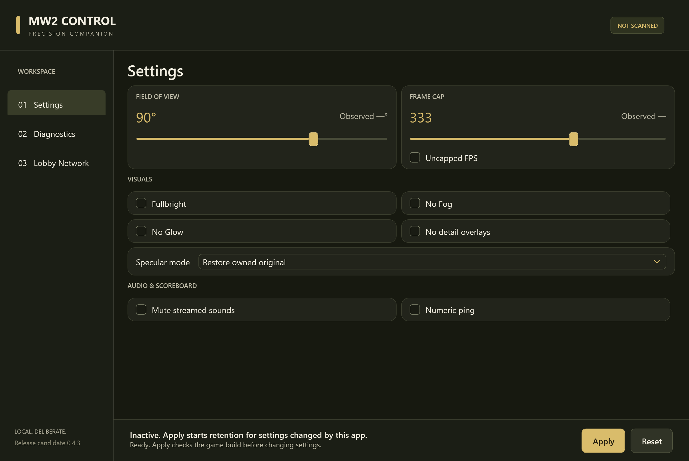
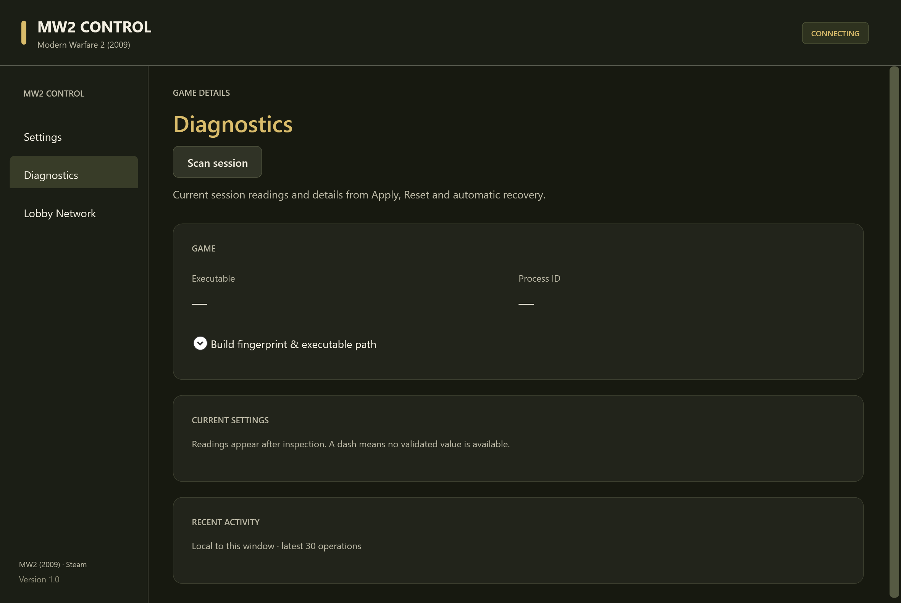
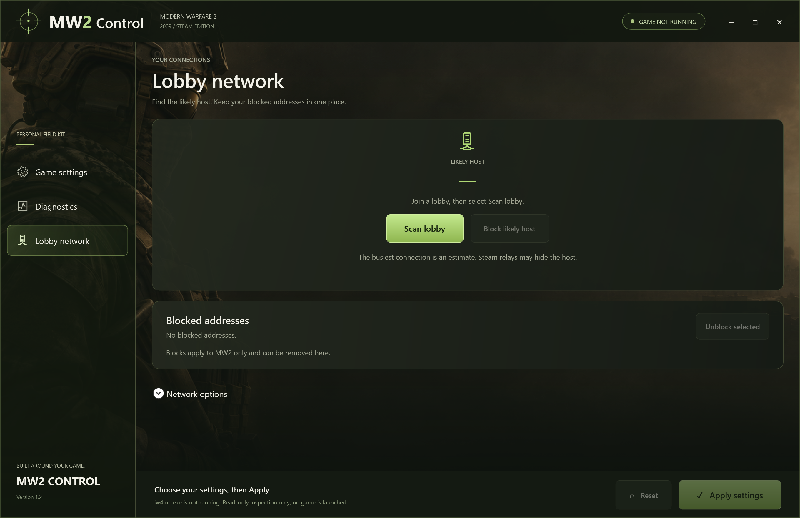

# MW2 Control for Call of Duty: Modern Warfare 2 (2009)

Windows x64 desktop tool for **MW2 (2009) Multiplayer on Steam**. Set your FPS cap and FOV, mute streamed audio, switch the scoreboard to numeric ping, and inspect lobby traffic.

**[Download for Windows x64](https://github.com/angelosmiliotis/mw2-control/releases/latest)** · [Quick guide](docs/START-HERE.txt)



<details>
<summary>See Diagnostics and Lobby Network</summary>

### Diagnostics



### Lobby Network



</details>

## Quick start

1. Download the Windows x64 ZIP from Releases and extract the entire folder.
2. Start **MW2 (2009) Multiplayer** through Steam and open `MW2Control.exe`. The release ZIP includes the .NET 8 Desktop Runtime.
3. Choose your settings and select **Apply**. Select **Reset** to stop retention and restore values the app still owns.

Game settings require a supported build of `iw4mp.exe`. Use them where modifications are permitted.

## Features

| Feature | What it does |
| --- | --- |
| FPS unlocker and FOV changer | Set an FPS cap or choose Uncapped. Startup requests default to 333 FPS and 90° FOV. |
| Stream Mute | Mutes streamed audio. In a live multiplayer test, footsteps, gunfire, explosions and the bomb timer remained audible. |
| Visual settings | Fullbright, fog, glow, specular mode and experimental detail-overlay controls. |
| Numeric ping | Displays the game's ping in milliseconds on the scoreboard. |
| Lobby Network | Shows the busiest observed IPv4 UDP peer and offers reversible firewall blocks for the selected endpoint. |
| Diagnostics | Shows the detected build, observed settings and recent actions. |

Install [Npcap](https://npcap.com/#download) for **Scan lobby**. Launch the app as administrator for **Block** or **Unblock**. The traffic leader is a possible host. Steam relays can make that estimate unreliable.

Apply retains eligible settings during the current game process. Apply again after restarting the game. Some settings may reset during map transitions, and FOV above 80° remains experimental.

## Build

Requires .NET 8 SDK and Windows for the WPF application.

```powershell
dotnet build src/MW2Control.App/MW2Control.App.csproj -c Release
dotnet run --project tests/MW2Control.Tests/MW2Control.Tests.csproj -c Release
dotnet run --project tests/MW2Control.Advanced.Tests/MW2Control.Advanced.Tests.csproj -c Release
dotnet run --project tests/MW2Control.Network.Tests/MW2Control.Network.Tests.csproj -c Release
dotnet run --project tests/MW2Control.App.Tests/MW2Control.App.Tests.csproj -c Release --no-launch-profile
pwsh -File scripts/Build-Preview.ps1
```

The last command publishes a framework-dependent preview under `out/preview-0.4.3`. Run `MW2Control.exe` from that folder and keep its files together. The app uses the Windows Desktop .NET 8 runtime, and lobby observation uses the installed Npcap driver.

See `docs/FINAL-TEST-GUIDE.md` for the staged live test and `docs/AUDIO-FINDINGS.md` for unresolved audio work. Synthetic results are in `docs/TEST-REPORT.md`; they are not a live compatibility or anti-cheat guarantee.

## Layout

- `src/MW2Control.Core` — profile identification, guarded external access, transactions.
- `src/MW2Control.App` — WPF interface and presentation state.
- `src/MW2Control.Network` — passive metadata observation and scoped owned firewall blocks.
- `tests/MW2Control.Tests` — synthetic tests, no real game access.
- `docs/TEST-REPORT.md` — actual test results and limitations, when generated.
